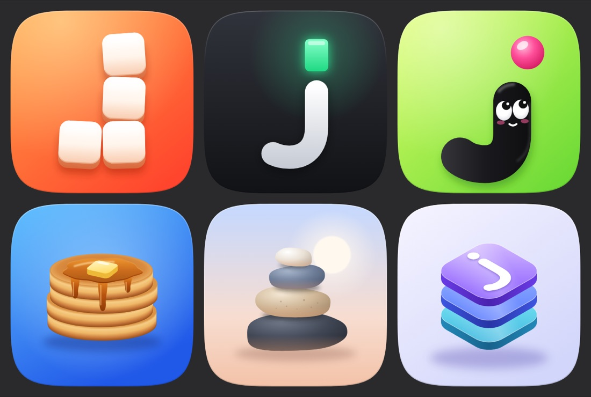
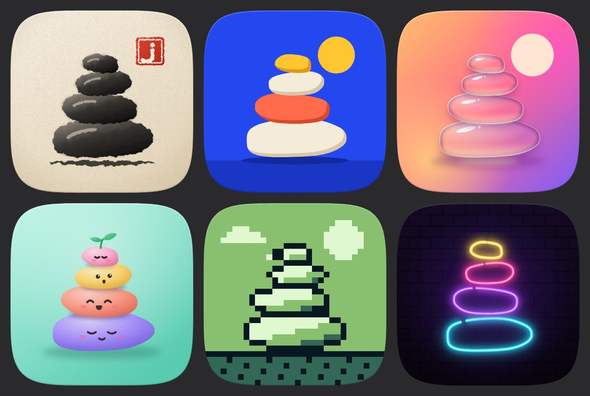
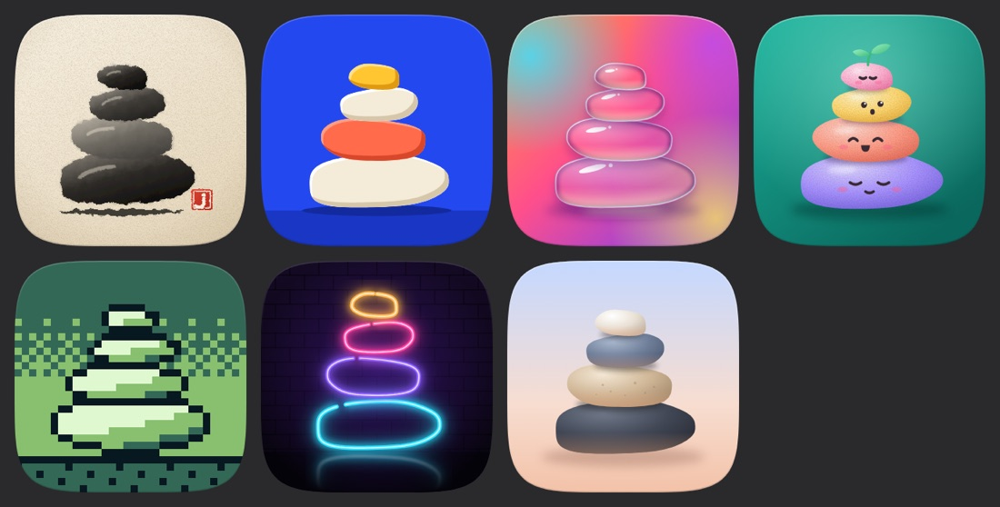

# jstack icon

The user requested an icon for jstack: four to six variants presented with grill-form, using [Icon Museum](https://icon.museum/) and [App Icons](https://www.appicons.store/) as references. Both galleries feature crafted iOS-style app icons with bold single concepts, rich color, soft dimensional lighting, and many mascots.

## Usage context

The Codex plugin manifest supports `interface.composerIcon`, `interface.logo`, and `interface.brandColor` (see the installed plugin-creator specification). The composer icon appears at small sizes, so each candidate was reviewed at 16, 20, and 28 px on light and dark backgrounds as well as at full size. Fungi has no app icon yet, so no candidate conflicts with an existing mark.

## Round 1: directions

Six directions were presented: Blocks (a J built from four stacked blocks), Prompt (a j whose dot is a terminal cursor), Jay (a j-shaped mascot), Short stack (pancakes, nodding to grill-me), Cairn (balanced stones), and Glass layers (isometric tiles marked with a j). A stacked bracket-fungus study was dropped before presentation: its bands read as rock strata, and a mushroom mark could collide with a future Fungi icon.

The recommendation was Jay. The user selected **Cairn** instead, noting that the stones are good, and asked to focus on that concept and branch out into six strikingly different styles. The user also accepted placing the final icon in the **plugin manifest** (composer icon, logo, and brand color) and the **README header**. A GitHub social preview was not selected. The optional per-icon comment question was left untouched.

## Round 2: cairn styles

The same four-stone cairn was rendered in six styles: Ink (sumi-e brushwork on paper with a red seal carved with a j), Flat (two-tone shapes on cobalt), Glass (refracting glass pebbles), Clay (pastel characters with a sprout), Pixel (an 8-bit handheld palette), and Neon (tube outlines on brick). The round-1 original was offered for comparison.

An early Flat draft used black, red, and gold horizontal bands, which read as a national flag; it was replaced before presentation. The recommendation was Ink: it is the clearest at 16 px, its seal carries the j, and its calm brushwork suits jstack's plain, lean rules.

The user chose no style and asked to remove the sun and redesign all of them. Ink, Flat, Glass, Pixel, and the original all included a sun or a sun-like disc; Ink's seal occupied the same position.

## Round 3: redesigned without a sun

The six styles are redesigned with the stones as the only subject: no sun or sky objects, larger stacks, and stronger contrast. Ink keeps its j seal as a small signature in the lower corner. The original is offered again without its sun for comparison. The recommendation is Flat: it is the boldest at 16 px, reduces cleanly to one brand color, and its plain shapes match jstack's plain UI rule.

## Outcome

The user selected **Original: realistic, no sun**: the round-1 cairn of four shaded stones on a blue-to-peach sky, without the sun. It is used unchanged.

- `assets/icon.svg` is the 1024 px vector master. `assets/logo.png` (512 px) and `assets/composer-icon.png` (64 px) were exported from it with `rsvg-convert -w SIZE -h SIZE assets/icon.svg -o FILE`; the corners outside the continuous-corner mask are transparent.
- The manifest sets `interface.logo`, `interface.composerIcon`, and `interface.brandColor: #4A5670`, the shadow tone of the slate-blue stone. The color was chosen from the icon and was not separately reviewed.
- The README floats the logo to the right of its introduction at 34% width, matching chartr's README, and clears it before the skills table.

The installed plugin validator and all skill frontmatter validators passed after the change. The icon has not been observed inside Codex's plugin interface. A GitHub social preview was not selected and remains out of scope.
